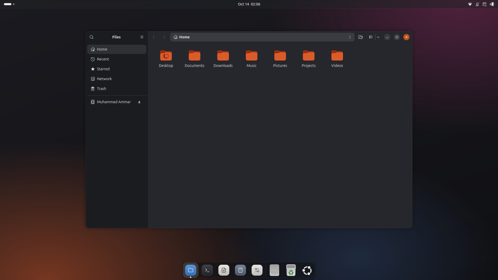
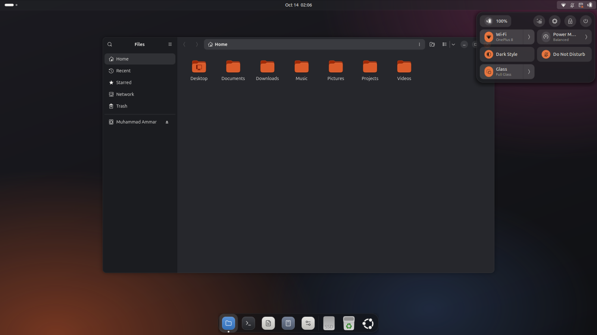
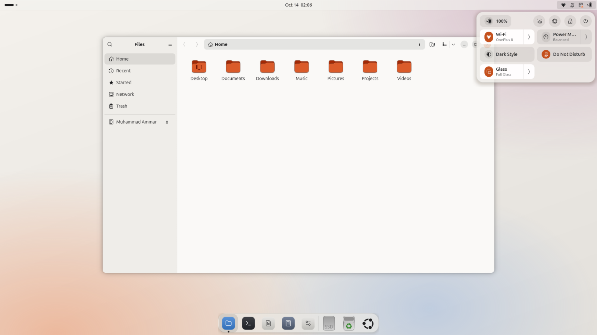
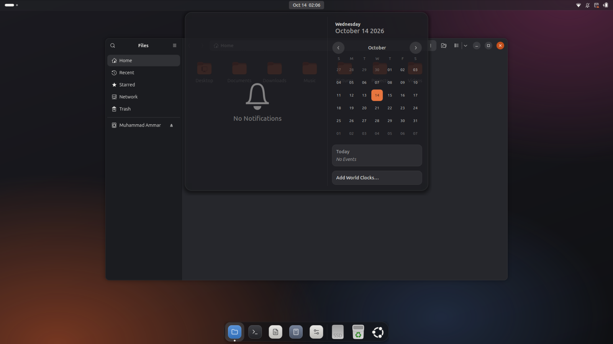
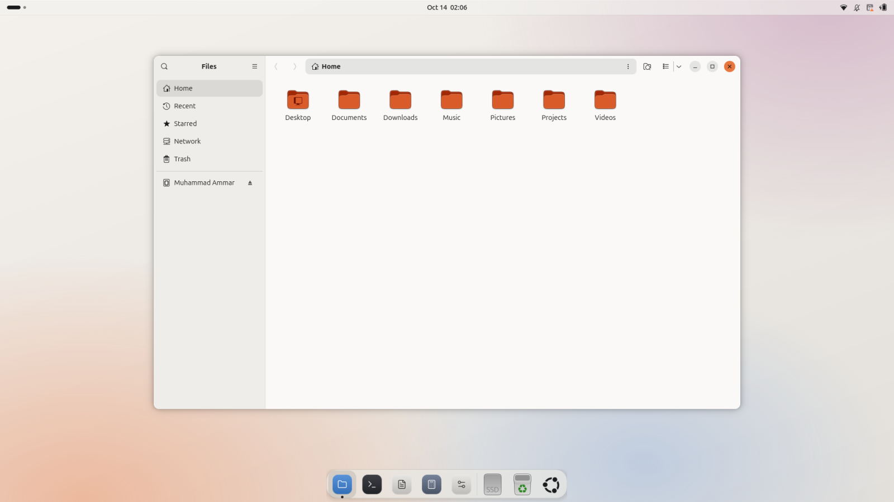
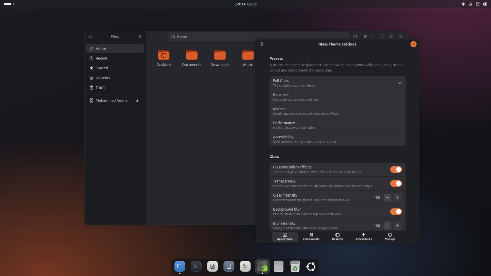
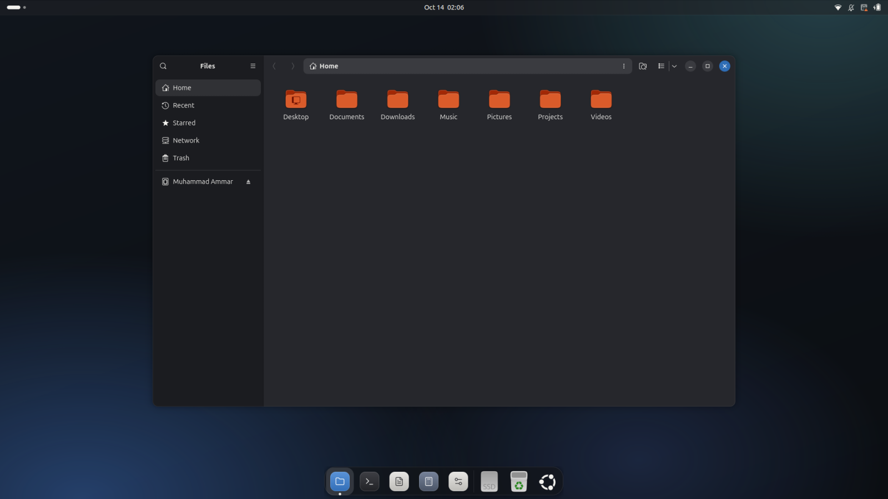

# Ubuntu Glass

A macOS- and iOS-inspired glass theme for Ubuntu's GNOME desktop. It borrows the material, spacing and calm of Apple's desktops and keeps Ubuntu's layout, accent and workflow.

Ubuntu Glass is a GNOME Shell extension with a settings window. Every effect can be switched on or off on its own, and everything the theme changes outside itself is backed up first and put back when you turn it off.



## Preview

| Dark | Light |
|---|---|
|  |  |
|  |  |
|  |  |

Top to bottom: quick settings in both modes, the calendar and the light desktop, then Glass Theme Settings and the Tide wallpaper with the Cool Blue accent. These are real screenshots of the extension on GNOME Shell 50.1 with the theme wallpaper and icon theme switched on, not mockups.

## What you get

- Translucent top bar and floating dock, with real background blur.
- Glass quick settings, notifications, calendar, menus, dialogs, overlays and overview.
- Matching colours, corner radii and window controls for GTK applications.
- Four wallpapers (Ember, Dusk, Tide, Graphite), each in a light and a dark version.
- An icon theme with rounded app tiles for 16 common applications.
- Light and dark appearances, five accent colours, and five presets.
- **Glass Theme Settings**, opened from the Glass tile in Quick Settings.

## Supported versions

| Ubuntu | GNOME Shell | Status |
|---|---|---|
| 26.04 LTS | 50 | Developed and tested here |
| 24.04 LTS | 46 | Declared as supported, **not tested** |
| other | 47, 48, 49 | Declared as supported, **not tested** |

The code avoids version-specific APIs and handles the one known difference (the blur effect's `sigma` property was renamed `radius` after GNOME 46), but nothing has been run on anything other than GNOME Shell 50.1. See [docs/testing.md](docs/testing.md).

## Install

```bash
./install.sh
```

This copies the extension to `~/.local/share/gnome-shell/extensions/` and the icon theme to `~/.local/share/icons/`. It needs no `sudo`, installs nothing system-wide, and changes no desktop setting.

Then:

1. Log out and back in. On Wayland, GNOME Shell only discovers new extensions at login.
2. Enable the extension:

   ```bash
   gnome-extensions enable ubuntu-glass@ammarqaisar11a55.github.io
   ```

3. Open **Glass Theme Settings** from the Glass tile in Quick Settings, or with:

   ```bash
   gnome-extensions prefs ubuntu-glass@ammarqaisar11a55.github.io
   ```

### What changes when you enable it

Enabling the extension, with default settings, does three things outside the shell's own appearance:

- **Moves the dock to the bottom** as a floating bar (Ubuntu Dock / Dash to Dock settings).
- **Writes a GTK stylesheet** to `~/.config/gtk-4.0/` and `~/.config/gtk-3.0/`, and adds one `@import` line to `gtk.css` there. Existing content in your `gtk.css` is kept.
- Nothing else. Wallpaper and icons are off by default.

Each of these is a switch in Glass Theme Settings, and each is undone when you turn the switch off or disable the extension.

## Glass Theme Settings

### Appearance

| Setting | When on | When off |
|---|---|---|
| Glassmorphism effects | Translucent glass surfaces | Solid fallback colours, no blur |
| Transparency | Wallpaper shows through | Surfaces are at least 96% opaque |
| Glass intensity (0–100) | 100 is the designed translucency | 0 is fully opaque |
| Background blur | Desktop is blurred behind the top bar and dock | No blur |
| Blur intensity (0–100) | 100 is the designed strength | — |
| Glass borders | Hairline edge on glass surfaces | Edges are transparent |
| Shadows and elevation | Drop shadows under panels, menus, dialogs | No shadows |
| Rounded corners | The theme's radius scale (5 to 24 px) | A small uniform radius |
| Appearance | Follow system, Dark, or Light | — |
| Accent colour | Ubuntu Orange, Cool Blue, Sage, Aubergine, Graphite, or follow system | — |

Choosing **Dark** or **Light** also switches the system style, and remembers what it was. **Follow system** restores it. If you change the system style yourself while a mode is forced, your choice wins and the setting returns to Follow system.

### Components

Each switch styles one part of the desktop. Turning one off restores the standard look for that part only.

| Switch | Covers |
|---|---|
| Top bar | Panel background, button hover and pressed states |
| Quick settings | Panel, tiles, accent icon discs, sliders |
| Notifications and calendar | Banners, notification list, calendar, date menu cards |
| Menus and tooltips | Popup menus, tooltips, switches, sliders, checkboxes |
| Dialogs and overlays | System dialogs, password prompts, volume and brightness overlays, Alt+Tab, lock screen |
| Overview and search | Search field, app grid, folders, search results |
| Floating glass dock | Dock position, shape and material |
| Dock animations | Dock hover and show/hide transitions |
| Window styling | GTK application colours, radii and window controls |

### Desktop

| Switch | Effect |
|---|---|
| Theme wallpaper | Sets one of the four wallpapers. Your previous wallpaper is restored when off. |
| Ubuntu Glass icons | Switches the icon theme. Your previous icon theme is restored when off. |
| Glass tile | Shows or hides the Glass tile in Quick Settings. |

### Accessibility

| Switch | Effect |
|---|---|
| Reduced motion | Removes the theme's transitions and dock animations. Also applied automatically when GNOME's own animation setting is off. |
| High contrast | Edges at 32% opacity, secondary text at full strength, surfaces at least 92% opaque. |

### Presets

A preset sets the glass options under Appearance. It never changes your wallpaper, icons, accent colour, appearance mode, or which components are styled.

| Preset | Glass | Intensity | Blur | Shadows | Motion | Contrast |
|---|---|---|---|---|---|---|
| Full Glass | on | 100 | on, 100 | on | on | normal |
| Balanced | on | 60 | on, 60 | on | on | normal |
| Minimal | on | 20 | off | on | on | normal |
| Performance | on | 40 | off | off | reduced | normal |
| Accessibility | off | — | off | on | reduced | high |

Changing one of those options by hand shows the preset as Custom. Setting them back to a preset's values selects that preset again.

### Manage

- **Enable all supported effects** turns on every glass effect and every component.
- **Disable optional decorative effects** turns off blur, transparency, borders, shadows and dock animations.
- **Export / Import** saves and loads your preferences as JSON. Unknown or invalid entries in an imported file are skipped and counted.
- **Restore Defaults** resets Glass Theme Settings after a confirmation. It does not touch other GNOME settings.

## How it is built

| Part | Mechanism | Where |
|---|---|---|
| Shell appearance | A stylesheet generated from design tokens and loaded on top of the Yaru shell theme | `extension/lib/css/`, `extension/lib/styleManager.js` |
| Background blur | `Shell.BlurEffect`, the effect GNOME uses for the lock screen | `extension/lib/blurManager.js` |
| Dock layout | Ubuntu Dock / Dash to Dock settings | `extension/lib/dockManager.js` |
| GTK applications | A generated stylesheet imported from the user's `gtk.css` | `extension/lib/css/gtk.js`, `extension/lib/gtkManager.js` |
| Wallpaper, icons, mode | Standard GNOME settings | `extension/lib/desktopManager.js` |
| Preferences | GSettings schema plus one model module | `extension/schemas/`, `extension/lib/model.js` |
| Settings window | libadwaita preferences window | `extension/prefs.js` |
| Quick Settings entry | Quick Settings menu toggle | `extension/lib/indicator.js` |
| Wallpapers | SVG generated from the mockup's gradients | `tools/build-wallpapers.py` |
| Icon theme | SVG generated from the mockup's tiles | `tools/build-icons.py` |

The stylesheet is generated rather than static so that every setting has a real effect: change a setting and the tokens are resolved again, the stylesheet is rebuilt, and only the sections for enabled components are included.

Nothing in GNOME Shell is patched or monkey-patched. The extension only loads a stylesheet, attaches an effect to two actors, adds one Quick Settings item, and writes ordinary settings.

## Known limitations

These are places where the approved mockup cannot be matched with supported GNOME interfaces, and what the theme does instead.

- **Menus and popovers are not blurred.** Blur is applied to the top bar and dock only. GNOME's blur effect is rectangular, and on a rounded popover with a shadow it shows as a blurred box around the panel. Popovers use the designed tint (72% dark, 78% light), which keeps text readable, but busy content behind them stays sharp.
- **The dock's blur has square corners.** Behind the dock's rounded corners a few pixels of blurred backdrop extend to the square. It is invisible over a wallpaper and faintly visible when a window sits under the dock.
- **Application windows are not translucent.** The compositor does not blur behind application windows, and a translucent window without blur is unreadable, so windows use the solid fallback colours. Colours, radii and window controls still follow the theme.
- **No top-edge highlight.** GNOME Shell's CSS allows one shadow per element, so surfaces have a drop shadow and a hairline border but not the mockup's additional 1 px inner highlight.
- **No dock magnification.** Ubuntu Dock has no hover-zoom, and adding one would mean replacing its icons.
- **Window styling applies when an application starts.** GTK reads user stylesheets at launch, so running applications keep their old look until restarted. The stylesheet also carries a light and a dark palette behind `prefers-color-scheme` so that GTK 4.20 and later can follow the system style without a restart; that path is not tested.
- **GTK 3 styling is minimal:** accent colour, window radius and the close button.
- **Snap applications keep their own icons.** Firefox, App Center and other snaps name their icon by file path, which no icon theme can override.
- **The icon theme covers 16 applications.** Everything else falls through to the icon theme you were using when you ran `install.sh`.
- **The login screen is not themed.** GDM runs as a different user and needs system-wide files. The extension stays loaded on the lock screen so that the unlock dialog gets the same stylesheet, but the lock screen's appearance has not been checked.
- **Flatpak applications** do not see `~/.config/gtk-4.0` unless given access, for example with `flatpak override --user --filesystem=xdg-config/gtk-4.0:ro`.

## Troubleshooting

**Something looks wrong and I want it off now.**

```bash
gnome-extensions disable ubuntu-glass@ammarqaisar11a55.github.io
```

This restores the dock layout, wallpaper, icon theme, system style and GTK stylesheets. Your Glass Theme Settings are kept.

**I cannot reach a terminal.** Switch to a text console with Ctrl+Alt+F3, log in, and run:

```bash
gsettings set org.gnome.shell disable-user-extensions true
```

Then return with Ctrl+Alt+F2 (or F1). This switches off all extensions. Set it back to `false` afterwards.

**The extension does not appear after installing.** Log out and back in. Then check `gnome-extensions list | grep ubuntu-glass`.

**The extension shows an error.** Read the shell log:

```bash
journalctl --user -b -o cat /usr/bin/gnome-shell | grep -i -E "ubuntu.glass|JS ERROR"
```

**The dock did not move.** The floating dock needs Ubuntu Dock or Dash to Dock. Without one of them the dock switches are shown as unavailable.

**The icon switch is greyed out.** The icon theme is not installed. Run `./install.sh` again.

**An application did not pick up the window styling.** Restart the application.

**The desktop feels slow.** Choose the Performance preset, or turn off Background blur.

## What is restored, and what is not

| Changed by the theme | Restored automatically |
|---|---|
| Dock position, length and theming options | Yes, when Floating glass dock is turned off or the extension is disabled |
| Dock animation time | Yes |
| Wallpaper (light, dark, and scaling mode) | Yes |
| Icon theme | Yes |
| System light/dark style | Yes |
| `ubuntu-glass.css` and the `@import` line in `gtk.css` | Yes, removed |

Not restored automatically:

- If the session ends without the extension being disabled (a crash or power loss), the saved values stay recorded and are restored the next time the extension is enabled and then disabled. Nothing is lost, but nothing is restored until then.
- If you remove the extension's files by hand while it is active, use `./uninstall.sh` afterwards. It removes the GTK stylesheets and falls back to the Yaru icon theme, but it cannot know your earlier dock layout or wallpaper.
- If you change a backed-up setting yourself while the theme is on (for example, pick a new wallpaper in Settings), turning the theme's switch off puts back the older value.

## Uninstall

```bash
./uninstall.sh
```

Disables the extension (which restores your settings), then removes the extension and the icon theme. Add `--purge` to also forget your Glass Theme Settings.

## Development

```bash
gjs -m tests/run.js      # unit tests: settings model, tokens, stylesheets
tests/headless.sh        # integration test in an isolated headless GNOME Shell
python3 tools/build-wallpapers.py
python3 tools/build-icons.py
```

`tests/headless.sh` starts a second GNOME Shell with its own home directory, runtime directory and D-Bus session. It cannot see or change your real desktop. See [docs/testing.md](docs/testing.md) for what it covers and the latest results.

## Credits

- Design: the "Ubuntu Glass" mockup in `Glassmorphism theme for Ubuntu/`.
- Icon glyph outlines: [Lucide](https://lucide.dev), ISC licence (see `icons/LICENSE.lucide`).
- Typeface: Ubuntu Sans, already the system font on Ubuntu.
